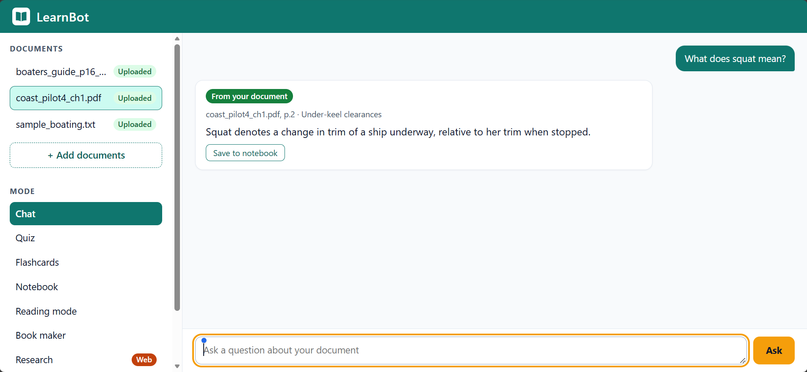
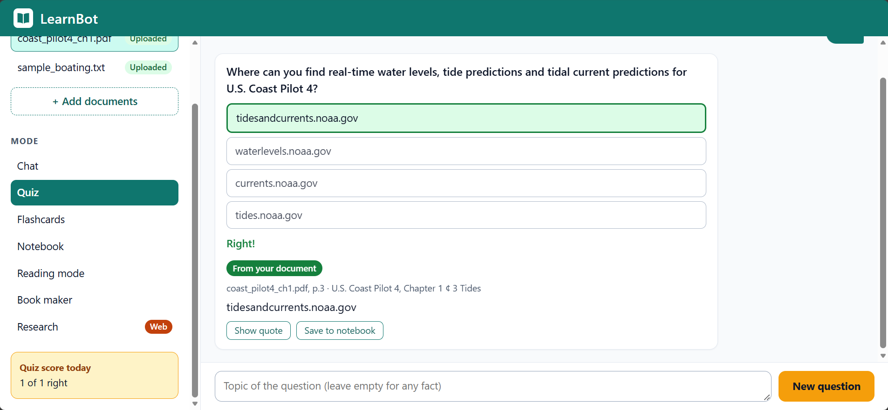
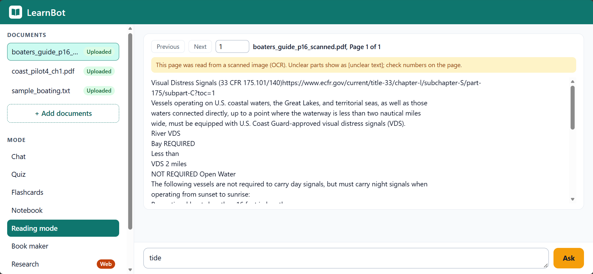
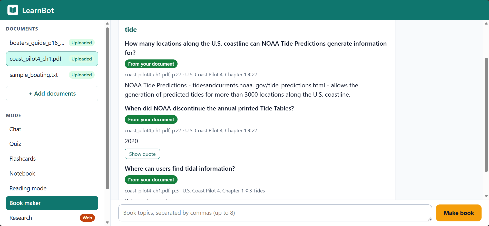
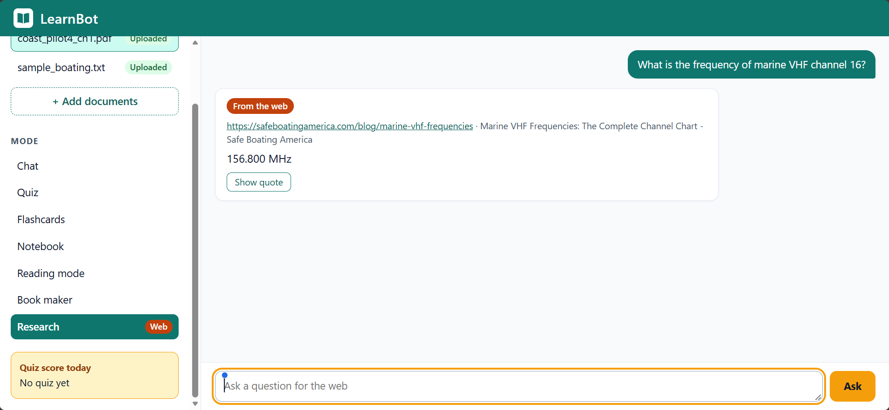

# LearnBot

An AI tutor that answers only from the file you upload, with the exact page and quote, or says "Not in this document".

Built for maritime crew training, but it works on any readable file of a supported type. It runs on your own laptop as one web page.

## Screenshots

| | |
|---|---|
|  |  |
| Chat: green label, location and answer (here the exact sentence, so no "Show quote" button) | Quiz: right and wrong option, source, today's score |
|  |  |
| Reading mode on a scanned page (OCR note) | Book maker: every fact with its page and quote |
|  | |
| Research: orange "From the web" label and the source link (safeboatingamerica.com) | |

## The 7 modes

| Mode | What it does |
|---|---|
| **Chat** | Ask a question about one file. The answer shows its location (page, line, slide, row...), and "Show quote" opens the exact sentence. |
| **Quiz** | One multiple-choice question per click, from a topic you type or from anywhere in the file. A question is kept only if its right answer is proved by the file. "Quiz score today" counts your answers. |
| **Flashcards** | One card per click: the front is a question, "Show answer" turns it over to the checked answer and its source. |
| **Notebook** | Save checked answers, quiz questions and flashcards, or type your own notes. Questions here are answered only from saved items ("Not in your notebook" otherwise). Your typed notes are labelled "Your note" and are never used as proof. |
| **Reading mode** | Read the exact text of one page, go to the next or previous page, and ask questions about that page only ("Not on this page" otherwise). |
| **Book maker** | Type up to 8 topics; LearnBot writes a short study book, one chapter per topic. Every line is a checked fact with its page and quote. The book is saved as a Markdown file. |
| **Research** | A separate web mode (Tavily). Every answer has the orange "From the web" label and its link, and is never mixed with your documents. |

## Supported file types

| Type | Location shown |
|---|---|
| PDF with a text layer | page ("p.12") |
| **Scanned PDF pages, read by OCR** (rapidocr, runs locally) | "p.3 (scanned, OCR)" |
| .docx | heading + paragraph |
| .pptx | slide |
| .xlsx (hidden sheets skipped), .csv | sheet + row |
| .txt, .md | line |
| .html | heading + paragraph |

Every file is checked first (size up to 50 MB, up to 1000 pages, readable text). Old Office formats (.doc, .xls, .ppt) get a clear message asking you to save them in the new format. Images (.png, .jpg) and any other type get a clear "can't be read" message.

## How it keeps answers exact

The AI suggests an answer and a quote. Code, not the AI, decides whether it may be shown:

- **Proof check.** The quote must be on the page it names, word for word. The page must be one of the pieces sent to the AI. Every number and unit in the answer must be in the quote, and every number in the quote must be in the answer or the question. A quote must have at least 4 words, and only one source is allowed unless the question compares two things. If any check fails, you see "Not in this document".
- **Rule sets.** If a question names a rule set (International or Inland), the answer must come from a page of that rule set.
- **Conditions rule.** If the quote has a condition ("except", "unless", "only if", "provided that", "other than", "excluding", "as long as") and the answer leaves it out, you see the document's exact sentence instead. A quiz question like that is dropped.
- **Limits rule.** If the quote has "more than", "at least", "up to", "less than" or "not more than" before a number and the answer leaves it out ("3000" for "more than 3000 locations"), you see the exact sentence instead. A quiz question like that is dropped.
- **Exact words.** If an answer uses content words that are not in its quote, you see the exact sentence instead. A leading paragraph number like "(36)" is removed.
- **Unclear OCR lines are never proof.** Each OCR line has a confidence score. A line below 0.97 becomes `[unclear text]`, and any quote that touches it is refused. Answers from scanned pages say "(scanned, OCR)" in their location.
- **Time limit.** Every AI and web call has a timeout. One question has 9 seconds in total, and if the AI is busy you get a friendly message, never a guess.

## Results

All numbers come from [eval/results.md](eval/results.md) and the progress log in [PLAN.md](PLAN.md). Every test set was written and committed before its run, and was run once with no tuning afterwards. "Wrong" means an answer was shown that the document does not support. Hard traps (questions where all the words are in the document, but the answer is not) are reported separately.

| Test | Right | Wrong | Traps refused | Slowest |
|---|---|---|---|---|
| Chat, 3 maritime PDFs (29 questions + 8 traps), prompt version 5 | 22/29 | **0** | 8/8 | 7.5 s |
| Chat, new non-maritime PDF (osha3124.pdf, 5 + 2), prompt version 4 | 3/5 | **0** | 1/2 refused, 0 answered (1 not tested, AI busy) | |
| Chat, hold-out set (10 + 2), prompt version 4 | 7/10 exact answers | **1** | 2/2 | |
| Flashcards (5 topics + 2 traps), prompt version 5 | 3/5 | **0** | 2/2 | 8.0 s |
| Quiz (5 topics + 2 traps), latest run on new topics | 2/5 kept, **not passed** (3 needed) | **0** | 2/2 | 8.7 s |
| Notebook (5 + 2) | 5/5 | **0** | 2/2 | 6.5 s |
| Reading mode (5 + 2) | 5/5 | **0** | 2/2 | 6.1 s |
| Book maker, new topics (5 + 2) | 4/5 (1 not tested, AI busy) | **0** | 2/2 | 9.0 s |
| Research (5 + 2) | 4/5 (re-scored 12 Nov; first scored 3/5) | **0** after two scoring changes ("156.800" = "156.8"; an exact-quote answer with every expected number); **1** in the original score | 2/2 | 9.0 s |
| Upload self-test, coast_pilot4_ch1.pdf | 5/5 (third try, not one clean run) | | normal traps 2/2 | 7.1 s |
| Conditions rule (5 + 2) | 4/5 | **0** | 2/2 | 8.0 s |
| File types .txt .md .csv .html .docx .pptx .xlsx (3 + 1 each) | 3/3 each | **0** | 1/1 each | |
| Scanned PDF page, OCR (3 + 1) | 3/3 | **0** | 1/1 | 2.6 s |

- **Hard traps:** 17 different hard traps were asked with Gemini first, and 16 were refused. Two are a known limit (see below).
- **OCR accuracy** on a scanned copy of a public page (`scripts/run_ocr_check.py`, boaters_guide.pdf p.16): 98.8% of words and all 11 numbers were read right, with 0 misread numbers.
- **Hold-out wrong answer:** the hold-out set (prompt version 4) had 1 wrong answer. It has not been re-run with the current rules.

## How to run on Windows

You need Python 3.13 and Git.

```powershell
git clone https://github.com/nehemiah2406/learnbot-lab.git
cd learnbot-lab
python -m venv .venv
.venv\Scripts\python -m pip install -r requirements.txt
copy .env.example .env
```

Open `.env` and fill in your own keys (never commit this file):

```
GEMINI_API_KEY=     # main AI (Google Gemini)
GROQ_API_KEY=       # backup AI (Groq)
TAVILY_API_KEY=     # Research mode only (web search)
# Optional: GEMINI_MODEL=, GROQ_MODEL= (defaults are in src/learnbot/config.py)
```

Start LearnBot by double-clicking `start_learnbot.bat`. If you've made a Desktop shortcut to it, that works too.

The page opens at http://127.0.0.1:8765. It runs on this laptop only. Wait until it stops saying "starting", then add a file with "+ Add documents". To stop LearnBot, close its window.

The first start also downloads the local search models (sentence-transformers) from Hugging Face, once.

## How to run the tests

```powershell
.venv\Scripts\python -m pytest
```

The tests use a fake AI, so they make no AI calls and cost no quota. A few tests need the public test PDFs in `data/raw/`; without them, those tests are skipped. The live evaluation scripts in `scripts/` (for example `run_filetype_eval.py --dry-run`) have a dry-run mode that uses no AI.

## Known limits

- **Slow start.** The page needs about 1-3 minutes before you can ask questions, while the search models load (measured: 69 s, 153 s and 155 s).
- **Hard traps.** The proof check tests words and numbers, not what a sentence is about. A question where all the words are in the document but the answer is not can still get an answer. Two such answers are known:
  - "How long does a tsunami warning stay in effect?" → "several hours" (that is how long the flooding may last).
  - A hurricane-watch wind speed taken from a mixed two-column page.
- **Quiz:** not passed yet (2 of 5 kept on the latest run; 3 needed). The checks drop many questions, which is safe but means fewer questions.
- **AI busy.** Free AI tiers are sometimes slow. A question then gets "The AI is busy right now. Please try again in a minute.", never a guess. After an internet outage the page can keep saying "AI busy" for up to about 4 more questions (restart it to clear). Each failed AI call is listed in `logs/ai_errors.log` (time, AI name, error type and seconds only).
- **OCR:**
  - It takes about 6-18 s per page, so a long scan takes minutes after upload.
  - Some letter swaps can still score above the 0.97 limit ("low" read for "law" on a blurred test copy), so check numbers on the page.
  - A scanned page with two columns may have its columns mixed.
  - Images (.png, .jpg) are not read yet.
- **Mixed columns.** Some PDF pages mix two columns line by line; reading mode warns about them, but answers from them can still be affected.
- **Research.** Web pages can change or be wrong. Answers are only as good as the page linked.
- **After uploading.** A new file's self-test runs in the background (about 10-20 AI calls, once per file). Until it finishes, a question gets "LearnBot is getting a new file ready. Please try again in a minute."

## Data credits

The test documents are public US government works (public domain). They are not included in this repo; download them into `data/raw/` with these names:

| File | Document | Source |
|---|---|---|
| `nav_rules.pdf` | U.S. Coast Guard, Navigation Rules and Regulations Handbook (corrected Aug 2024) | https://www.navcen.uscg.gov/navigation-rules-amalgamated |
| `boaters_guide.pdf` | U.S. Coast Guard, A Boater's Guide to the Federal Requirements for Recreational Boats (revised Nov 2023) | https://www.uscgboating.org/assets/1/AssetManager/Boaters-Guide-to-Federal-Requirements-for-Receational-Boats-20231108.pdf |
| `coast_pilot4_ch1.pdf` | NOAA, U.S. Coast Pilot 4, Chapter 1 "General Information" (25 Oct 2026 edition) | https://nauticalcharts.noaa.gov/publications/coast-pilot/files/cp4/CPB4_C01_WEB.pdf |
| `osha3124.pdf` | OSHA, Stairways and Ladders: A Guide to OSHA Rules (OSHA 3124-12R, 2003) | https://osha.gov/Publications/osha3124.pdf |

## Credits

Inspired by [DeepTutor](https://github.com/HKUDS/DeepTutor) (HKUDS). All code here is our own.

Built by Hari P (Data Science Intern).
